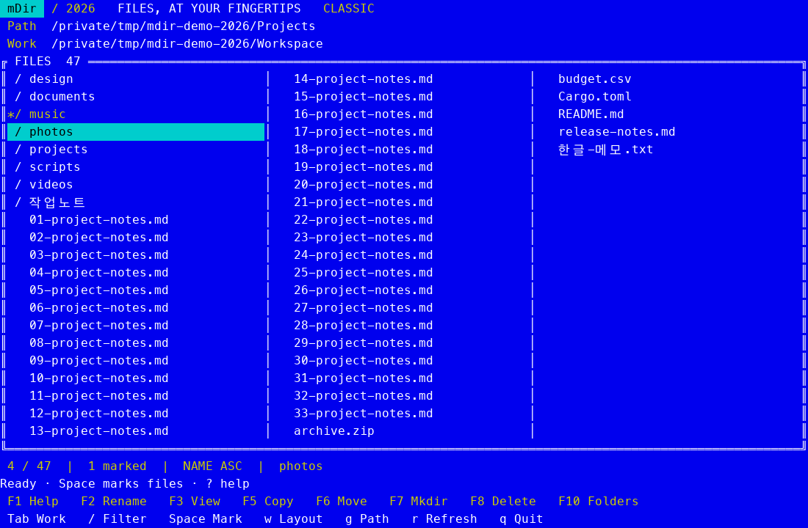

# mDir 2026

DOS Mdir III의 다단 목록과 키보드 조작을 현대 터미널로 옮긴 Rust 파일 관리자입니다. **현재 버전은 0.1.0**이며 원작자의 공식 후속 버전은 아닙니다.



터미널 테마에 따라 색상이 달라집니다.

## 지금 실행하기

소스에서 빌드하려면 저장소를 내려받은 뒤 mise로 개발 환경을 맞춥니다.

```sh
git clone https://github.com/TylerShin/mdir.git
cd mdir
mise trust
mise install
mise run build
./target/release/mdir
```

현재 폴더와 작업 폴더를 지정하면 복사·이동의 목적지가 분명해집니다.

```sh
./target/release/mdir ~/Downloads ~/Documents
```

빌드한 네이티브 바이너리를 한 줄로 설치합니다. 기본 위치는 `~/.local/bin/mdir`이며 셸 설정은 자동으로 바꾸지 않습니다. 설치된 실행 파일은 Rust 런타임 없이 동작합니다.

```sh
sh scripts/install.sh --local
```

`~/.local/bin`이 PATH에 있으면 `mdir`로 실행합니다. 없으면 `~/.local/bin/mdir`를 실행하거나 해당 폴더를 PATH에 추가하세요.

## 조작

| 키 | 동작 |
| --- | --- |
| ↑/↓, j/k · ←/→ | 커서 이동 · 다단 목록의 열 이동 |
| Enter / l · Backspace / h / . | 폴더 열기 · 상위 폴더 |
| Tab / Alt-W | 현재·작업 폴더 전환 |
| w · 1–6 | 다단/2패널 전환 · 열 개수 |
| g · `\` | 경로 입력(Windows 드라이브/UNC 포함) · 현재 볼륨 루트 |
| `/` | 즉시 필터; Enter 유지, Esc 해제 |
| Space · u | 여러 항목 선택 · 선택 해제 |
| o · s · Alt-N/E | 이름/확장자 정렬 · 역순 · 정렬 기준 지정 |
| p / v / F3 / Alt-V | 64 KiB 제한 텍스트 미리보기 |
| c / F5 / Alt-C / Ins | 작업 폴더로 복사 |
| m / F6 / Alt-M | 작업 폴더로 이동 |
| e / F2 / Alt-R | 현재 항목 이름 변경 |
| n / F7 | 폴더 생성 |
| d / F8 / Alt-D / Del | 영구 삭제, 반드시 확인 |
| t / F10 | 폴더만 표시하는 MCD식 탐색 |
| r · ? / F1 · q / Ctrl-C | 새로고침 · 도움말 · 종료 |

복사·이동·삭제는 표시된 선택 항목이 있으면 선택한 항목 전체에 적용됩니다. 필터로 숨긴 선택 항목도 유지되므로 확인 화면에 나온 경로를 확인하세요. 모든 변경은 별도 `y`로 확정하고 `n`/Esc로 취소합니다. 긴 확인 내용과 미리보기는 방향키, PageUp/Down, Home/End로 스크롤할 수 있습니다. 작업은 순서대로 수행하고 첫 실패에서 멈추며 완료 개수를 표시합니다. 이미 완료한 항목은 자동 롤백하지 않습니다.

macOS에서 Option/F키를 OS가 가로채더라도 일반 문자키로 조작할 수 있습니다. `--ascii`는 ASCII 테두리, `--mono` 또는 `NO_COLOR`는 흑백 모드입니다. 특수 폰트, Kitty/Sixel, 이미지 프로토콜이 필요하지 않습니다.

## 지원 범위

- macOS, Linux, Windows를 위한 플랫폼별 파일 작업을 구현했습니다.
- 파일 복사, 파일/폴더의 동일 파일시스템 이동·이름 변경, 파일/빈 폴더 삭제를 제공합니다.
- 복사는 비공개 임시 파일을 완성한 다음 원자적으로 게시합니다. 기존 파일을 덮어쓰지 않습니다. Unix 일반 권한과 실행 비트를 보존합니다.
- Esc는 복사를 취소합니다. 복사 도중 Ctrl-C는 정리 후 종료합니다. 입력 대기 중에는 다시 그리지 않고, 목록/미리보기/파일 작업은 백그라운드에서 처리합니다.
- 재귀 폴더 복사·삭제, 심볼릭 링크 작업, 볼륨 간 이동, 압축파일 탐색, 외부 프로그램 실행, 크기/시간 정렬, 디렉터리 전체 트리는 아직 없습니다. F10은 현재 폴더의 하위 폴더 탐색입니다.
- ACL, 확장 속성, 소유자, 타임스탬프를 완전히 복제하지 않습니다. Windows의 새 파일 ACL은 대상 폴더의 정책을 따릅니다. 일반 사용자 디렉터리를 전제로 하며 외부 프로세스가 경로를 동시에 바꾸는 상황까지 격리하지 않습니다.
- 강제 종료·전원 차단에서는 `.mdir-copy-*` 임시 파일이 남을 수 있습니다. 멈춘 네트워크 파일시스템의 시스템 호출을 강제 중단하지는 못합니다.

## 개발 환경: mise

Rust **1.92.0**과 rustfmt/clippy를 `mise.toml`에 고정했습니다. 일반 Cargo 사용자도 같은 도구를 쓰도록 `rust-toolchain.toml`을 함께 둡니다. 의존성은 `Cargo.lock`으로 고정합니다.

```sh
mise trust
mise install
mise run dev
mise run check
mise run build
python3 scripts/smoke.py
mise run bench
```

Python은 Unix PTY 검증에만 필요하고 앱 실행에는 필요하지 않습니다. 소스에서 빌드할 때는 OS의 네이티브 링커가 필요합니다(macOS Command Line Tools, Linux C 컴파일러, Windows MSVC Build Tools). 일반 사용자는 빌드된 바이너리를 받으면 됩니다.

## 배포 준비

공개 저장소는 [TylerShin/mdir](https://github.com/TylerShin/mdir)입니다. **인터넷 한 줄 설치는 첫 바이너리 릴리스 발행 후 사용할 수 있습니다.** [CI](.github/workflows/ci.yml)는 macOS/Linux/Windows x64·ARM64의 6개 타깃을 빌드하며, `v*` 태그에서 모두 성공하면 실행 파일·설치 스크립트·`SHA256SUMS`를 릴리스에 올립니다. Linux는 musl 정적 링크, Windows MSVC는 정적 CRT를 사용합니다.

첫 릴리스를 발행한 뒤에는 아래 명령으로 설치할 수 있습니다.

```sh
curl -fsSL https://github.com/TylerShin/mdir/releases/latest/download/install.sh | sh -s -- --repo TylerShin/mdir
```

Windows는 배포된 `install.ps1`을 내려받아 `./install.ps1 -Repo TylerShin/mdir`로 설치합니다. 설치기는 SHA-256을 확인한 후 사용자 폴더에 저장하며 관리자 권한을 요구하지 않습니다. 다운로드 경로와 체크섬을 같은 릴리스에서 가져오므로 이것이 별도 코드 서명을 대체하지는 않습니다.

## 라이선스

[MIT License](LICENSE) · Copyright © 2026 Tyler Shin.
저작권·라이선스 고지를 유지하면 누구나 사용, 수정, 재배포하거나 상업적으로 이용할 수 있습니다.
원본 Mdir와 의존 라이브러리의 권리는 각각의 권리자에게 있습니다.
